# Data Science Project Canvas
## Demand Analysis and Forecasting for Grocery Retail Operations

*An MBA Operations Management & Data Science Project Canvas*

---

## 1. Visual Canvas Overview

```mermaid
flowchart TD
    subgraph Business_Context["1. Business Problem & Objectives"]
        B1["Goal: Inform store staffing, replenishment & promo planning"]
        B2["Stakeholders: Store Ops, Category Planners, Supply Chain"]
        B3["Core Question: How can historical data support retail operations?"]
    end

    subgraph Data_Foundations["2. Data & Ingestion Architecture"]
        D1["Fact Table: train.csv (3M rows, daily store x family sales)"]
        D2["Store Master: stores.csv (54 stores, 16 states, 17 clusters)"]
        D3["Context: transactions.csv, holidays_events.csv, oil.csv"]
        D4["Cleaning: Validation merges (many-to-one), oil ffill/bfill, scope joins"]
    end

    subgraph Analytics_Engine["3. Feature Engineering & Modeling"]
        F1["Features: Lags (1, 7, 14, 28), Rolling (7, 28-day), Calendar"]
        F2["Domain Signals: Quincena Paydays, Multi-scope Holidays, Promo Intensity"]
        M1["Baselines: Moving Average (28d), Seasonal Naive (7d)"]
        M2["ML Models: Ridge/Linear Regression, Random Forest Regressor"]
    end

    subgraph Decision_Execution["4. Evaluation & Operational Deployment"]
        E1["Metrics: MAE (units), RMSE (penalize outliers), RMSLE (relative error)"]
        E2["Validation: Leakage-safe chronological backtesting"]
        O1["Operations: Differentiated inventory reviews (Smooth vs Lumpy)"]
        O2["Staffing: Quincena & weekend labor adjustments"]
    end

    subgraph Governance_Constraints["5. Constraints & Monitoring"]
        C1["Boundary: Observed sales != Unconstrained demand (no stockout data)"]
        C2["Inference: Descriptive associations != Causal effects"]
        C3["Monitoring: Tracking volume shifts, macroeconomic shocks & drift"]
    end

    Business_Context --> Data_Foundations
    Data_Foundations --> Analytics_Engine
    Analytics_Engine --> Decision_Execution
    Decision_Execution --> Governance_Constraints
```



---

## 2. Detailed Canvas Specification

| Canvas Block | Focus Area | Detailed Specification & Project Implementation |
|---|---|---|
| **1. Business Problem & Value Proposition** | **Problem Statement** | Grocery retailers face erratic daily demand driven by day-of-week cycles, bi-weekly paydays (*Quincenas*), promotions, and external shocks. Inaccurate planning leads to stockouts in high-velocity categories, excessive perishable waste, and staffing misallocations during weekend peaks. |
| | **Value Proposition** | Move store and category management from intuition-driven guesswork to an evidence-backed, segmented planning framework. Differentiate replenishment and staffing policies between stable high-volume essentials and highly volatile categories. |
| **2. Key Stakeholders & Decision Context** | **Primary Stakeholders** | • **Store Operations Managers:** Shift staffing, checkout capacity, weekend labor planning.<br>• **Category & Inventory Planners:** Replenishment cycle length, buffer stock sizing, promotional staging.<br>• **Supply Chain Logistics:** Distribution center dispatch schedules and regional truck deliveries.<br>• **Executive Leadership (COO / VP Retail):** Capital allocation across store types and format performance evaluation. |
| | **Decisions Supported** | • *Staffing:* How many checkout and stocking staff are needed on Friday–Sunday and Quincenas?<br>• *Replenishment:* Which categories allow weekly replenishment vs. daily review?<br>• *Promotions:* Which categories respond with volume lift vs. baseline cannibalization? |
| **3. Current Baseline & Heuristics** | **Existing Practices** | • Static rule-of-thumb ordering (e.g., ordering identical quantities each Tuesday).<br>• Uniform safety stock percentages across all 33 categories without considering volatility ($CV$).<br>• Reactionary labor scheduling with weekend bottlenecking and understaffed checkout lines. |
| | **Analytical Benchmark** | • **28-Day Moving Average:** Naive trailing mean of past demand.<br>• **7-Day Seasonal Naive:** Assuming this Monday replicates last Monday ($y_{t} = y_{t-7}$). Any viable machine learning model must beat this benchmark to justify operational complexity. |
| **4. Data Sources, Grain & Ingestion** | **Primary Fact Table** | `train.csv`: 3,000,888 historical rows spanning Jan 1, 2013 to Aug 15, 2017.<br>**Grain:** Exactly 1 row per `date` × `store_nbr` × `family` (1,684 dates × 54 stores × 33 families). |
| | **Contextual Master Tables** | • `stores.csv`: 54 stores with city, state, store type (A–E), and cluster (1–17).<br>• `transactions.csv`: Daily foot traffic / checkout transactions per store (83,488 rows).<br>• `holidays_events.csv`: 350 events classified into National, Regional, and Local scope.<br>• `oil.csv`: Daily WTI crude price (macroeconomic proxy for Ecuadorian purchasing power). |
| | **Data Ingestion Rules** | Controlled file whitelist (`EXPECTED_FILES`), automated datetime parsing upon load, and strict file existence profiling before analysis execution. |
| **5. Data Preparation & Quality Assurance** | **Missing Value Strategy** | • *Oil:* Forward-filled across non-trading weekends/holidays with explicit audit indicator `oil_value_missing`.<br>• *Transactions:* Left-joined; missing records explicit (store closures or new store ramp-ups).<br>• *Sales Zeros:* 31.30% of records are zero sales; analyzed via Syntetos-Boylan intermittency rather than treated as missing data. |
| | **Integrity & Grain Guards** | • All joins strictly validated with `validate="many_to_one"`.<br>• Assertion checks verify total row count matches exactly 3,000,888 and composite key `(date, store_nbr, family)` is unique. |
| **6. Feature Engineering & Domain Signals** | **Calendar & Seasonality** | Downcasted integer date attributes: `year`, `month`, `quarter`, `week`, `day_of_week`, `day_of_month`, `is_weekend`. |
| | **Lag & Rolling Dynamics** | Chronologically leakage-safe features computed strictly within `(store_nbr, family)` series:<br>• `lag_1` (yesterday's momentum)<br>• `lag_7` (day-of-week weekly seasonality)<br>• `lag_14` (bi-weekly replenishment cycle)<br>• `lag_28` (monthly baseline)<br>• `rolling_mean_7` & `rolling_mean_28` (shifted by 1 period to prevent lookahead bias). |
| | **Domain & Event Signals** | • *Quincena Paydays:* Flags for the 15th and month-end wage payouts (+1 day shopping window).<br>• *Geographic Holiday Scope:* Distinct flags for national, state-level regional, and city-level local holidays (excluding transferred events).<br>• *Promotion Intensity:* Log-transformed active promotional item count ($\log(1 + \text{onpromotion})$). |
| **7. Modeling Strategy & Formulations** | **Baseline Models** | 1. **28-Day Moving Average** (trend baseline)<br>2. **7-Day Seasonal Naive** (cyclical baseline) |
| | **Supervised ML Models** | 1. **Ridge / Linear Regression with Lags:** Interpretable linear feature weights.<br>2. **Random Forest Regressor:** Non-linear decision trees capturing interactions between calendar, lag momentum, promotions, and store format. |
| | **Validation Architecture** | Chronological rolling validation window (last 24 months, evaluated over a 16-day forecast horizon matching Kaggle and store replenishment planning cycles). Zero random train/test shuffling. |
| **8. Evaluation Metrics & Trade-offs** | **Statistical Metrics** | • **MAE (Mean Absolute Error):** Direct, interpretable measurement in units sold. Primary operational metric for inventory replenishment.<br>• **RMSE (Root Mean Squared Error):** Heavily penalizes large forecasting misses, highlighting severe stockout or overstock risks.<br>• **RMSLE (Root Mean Squared Log Error):** Evaluates relative percentage deviations without being dominated by high-volume categories. |
| | **Post-Processing Rule** | Demand cannot be negative: all model predictions are clipped at zero ($\hat{y} = \max(0, y_{\text{pred}})$). |
| | **Operational Trade-offs** | Under-forecasting risks out-of-stock lost sales and customer dissatisfaction; over-forecasting perishable items (Produce, Dairy, Meats) causes spoilage and margin erosion. |
| **9. Operational Deployment & Workflow** | **Portfolio Segmentation** | • **Smooth Demand:** Grocery I, Beverages, Cleaning (Standard automated moving averages / ML; weekly replenishment cadence).<br>• **Erratic Demand:** Produce, Meats (High volume, high volatility; daily replenishment review, dynamic safety buffers).<br>• **Intermittent / Lumpy Demand:** Books, Lawnmowers (Croston-style replenishment, pull-based ordering rather than push-based forecasting). |
| | **Store Tiering** | High-volume flagships (Stores 44, 45, 47) receive dedicated logistics lanes, whereas high-variability stores (Store 25) maintain agile buffer stocks. |
| | **Staffing Workflows** | Saturday/Sunday checkout staffing increased by ~40% to match weekend peak volume (825k vs 500k midweek units); store labor augmented on 15th and 30th for Quincena rushes. |
| **10. Risks, Assumptions & Caveats** | **Observed Sales $\neq$ Demand** | The dataset records *censored sales*, not true customer demand. If an item was stocked out or a store closed, demand was strictly positive but recorded as zero. |
| | **Descriptive $\neq$ Causal** | Promotions, oil prices, and transactions are observed associations. Higher sales on promoted days does not prove promotion alone caused the lift (selection bias). |
| | **Mixed Physical Units** | The `sales` metric aggregates kilograms, liters, count packs, and apparel into a single number. Aggregates represent activity volume, not revenue, margin, or pallet weight. |
| **11. Monitoring, Drift & Continuous Learning** | **Drift Triggers** | • **Structural Shocks:** Natural disasters (e.g., April 2016 Manabí earthquake causing sudden surge in essentials and drop in discretionary goods).<br>• **Macroeconomic Trends:** Sustained crude oil drops affecting national purchasing power.<br>• **Calendar Shifts:** Floating holidays (Carnival, Easter) shifting across weeks year-over-year. |
| | **Model Retraining Schedule** | Monthly batch retraining with updated lags and dynamic rolling recalibration. |

---

## 3. Operations Management Decision Matrix

```
                      DEMAND UNCERTAINTY (CV)
                 Low Volatility      High Volatility
               +-------------------+-------------------+
          High | ROUTINE AUTOMATION| AGILE REPLENISH   |
               | - Grocery I       | - Produce, Meats  |
        VOLUME | - Beverages       | - High Promo Items|
               | Policy: Weekly    | Policy: Daily     |
               | replenishment,    | review, dynamic   |
               | standard safety   | buffer stocks,    |
               | stocks            | supplier sync     |
               +-------------------+-------------------+
           Low | LOW TOUCH / LEAN  | EXCEPTION-BASED   |
               | - Hardware        | - Books, Seasonal |
        VOLUME | - Baby Care       | - School Supplies |
               | Policy: Min/Max   | Policy: Make/Order|
               | reorder points,   | to order, Croston |
               | low buffer capital| intermittency     |
               +-------------------+-------------------+
```

---

## 4. Summary Checklist for Business Review

- [x] **Clear business question defined** (Operations & demand planning, not just a Kaggle competition rank).
- [x] **No ungrounded inventory claims** (Explicitly recognizes absence of stockout, inventory, and margin data).
- [x] **Leakage-safe feature engineering** (Strict chronological sorting and shift-1 rolling statistics).
- [x] **Multi-tiered benchmarks established** (Moving Average & Seasonal Naive compared against ML).
- [x] **Actionable operational recommendations** (Quincena staffing, weekend scheduling, portfolio segmentation).
