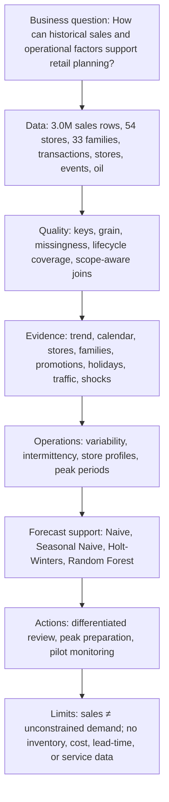

# Data Science Project Canvas
## Demand Analysis and Forecasting for Grocery Retail Operations

*MBA Operations Management project supported by data science*

## 1. Visual canvas

## 2. Detailed canvas

| Canvas block | Project implementation |
|---|---|
| **Business problem** | Grocery operations must plan staffing, receiving, shelf replenishment, promotions, and supplier coordination under changing demand. The project identifies patterns that can inform planning; it does not observe stockouts, waste, labor performance, or financial outcomes. |
| **Stakeholders** | Store operations, category planning, replenishment, supply-chain coordination, and management. |
| **Core decisions supported** | Which stores, categories, and periods deserve closer planning review? Which demand series are stable, intermittent, or volatile? Do forecasts add value beyond transparent baselines? |
| **Data source** | Kaggle Store Sales competition: 3,000,888 training rows from 2013-01-01 to 2017-08-15, 54 stores, 33 families, plus store, transaction, holiday/event, oil, test, and submission files. |
| **Core grain** | One `date × store_nbr × family` row. The complete panel has 1,684 × 54 × 33 rows and a unique composite key. |
| **Quality controls** | File whitelist, datetime validation, duplicates, nulls, invalid values, zero sales, robust extremes, key integrity, merge-cardinality checks, store lifecycle coverage, and post-merge row-count validation. |
| **Missing values** | Oil is aligned to a daily calendar and filled through time with an imputation flag. Missing transactions remain missing. Zero sales remain observed values because the dataset cannot distinguish no demand, closure, or unavailable stock. |
| **Holiday integration** | Non-transferred national events apply to all stores; regional events match state; local events match city. This prevents a many-to-many date-only join. |
| **Calendar features** | Year, month, quarter, ISO week, weekday, day of month, weekend flag. |
| **Forecast features** | Lags 1, 7, 14, and 28; shifted rolling means 7 and 28; calendar, promotion, and holiday fields. All rolling features use prior information only. |
| **Descriptive domain signals** | Promotion state, scope-aware holidays, transaction traffic, oil-price context, semi-month boundary proxy, and an equal-window April 2016 event comparison. These are associations, not causal effects. |
| **Core EDA** | Network trend, calendar seasonality, store ranking and variability, store type/cluster/geography, family contribution and variability, store–family heatmap, promotions, holidays, transactions, and oil. |
| **Advanced EDA** | ADI/CV² classification of 1,782 store–family series; semi-month boundary comparison; equal 30-day pre/post event window; cross-family correlation of daily log-sales changes after removing the daily common component. |
| **Operations segmentation** | Median demand and CV create high/low demand × stable/volatile family groups. Store lifecycle coverage is separated from mature-store variability. |
| **Forecast procedures** | One-day Naive, seven-day Seasonal Naive, additive Holt-Winters with weekly seasonality, and Random Forest using leakage-safe features. |
| **Validation** | Chronological 60-day holdout for three representative series. Random Forest is a rolling one-day procedure; Holt-Winters is a fixed 60-day path, so update schedules are not identical. |
| **Metrics** | MAE for absolute error, RMSE for larger-error sensitivity, and RMSLE for relative-error perspective. Negative predictions are clipped to zero. |
| **Best average result** | Random Forest: MAE 414.41, RMSE 592.87, RMSLE 0.258. Holt-Winters is best for Store 32–Frozen Foods, so no universal winner is claimed. |
| **Managerial output** | Finding → Operational implication → Possible action → Limitation. Actions focus on differentiated review, local validation, recurring peak preparation, and pilot monitoring. |

## 3. Operations decision matrix

| Demand profile | Planning interpretation | Qualified action |
|---|---|---|
| High demand / Stable | Large flow with comparatively predictable history | Candidate for regular planning cycles with exception monitoring |
| High demand / Volatile | Commercially important and uncertain | Candidate for shorter review cycles, scenarios, and closer supplier coordination |
| Low demand / Stable | Smaller flow with comparatively stable history | Candidate for lower-frequency review where service risk permits |
| Low demand / Volatile | Small flow with unstable percentage changes | Use exception review and avoid overreacting to noisy rates |
| Intermittent / Lumpy store–family series | Positive sales are infrequent and/or variable | Test intermittent-demand methods and monitor all-zero series separately |

These actions do not specify order quantities, safety stocks, or labor levels.

## 4. Evidence highlights

- Grocery I, Beverages, Produce, and Cleaning contribute approximately **72.7%** of observed family-level sales.
- Average network demand is highest on **Sunday (825.2k)** and **Saturday (772.2k)**; December is the highest month at **808.6k** average daily sales.
- Across 1,782 store–family series: **630 Smooth, 593 Intermittent, 324 Lumpy, and 235 Erratic**.
- The semi-month boundary proxy is associated with **4.52%** higher average network sales before calendar controls.
- Manabí average daily sales are **64.91%** higher in the equal 30-day post-event window; Santa Elena is **38.77%** lower. This is temporal association.
- Random Forest has the lowest average MAE, but Holt-Winters wins one of the three selected series.

## 5. Governance and limitations

- Observed sales may be constrained and are not unconstrained demand.
- Mixed sales units are not revenue, margin, weight, or handling effort.
- Promotion, holiday, semi-month, transaction, oil, and event analyses are observational.
- Correlation does not establish complementarity, substitution, or causation.
- The dataset cannot calculate inventory optimization or financial improvement.
- A production retraining schedule, labor quantity, or replenishment cadence requires additional operating constraints and a live pilot.

## 6. Completion checklist

- [x] Broad Operations Management question defined.
- [x] All seven source files audited.
- [x] Raw data preserved and excluded from Git.
- [x] Scope-aware, cardinality-validated integration completed.
- [x] Full network and justified detailed-scope analysis completed.
- [x] Leakage-safe chronological forecast comparison completed.
- [x] Findings linked to implications, actions, and limitations.
- [x] Six notebooks executed top-to-bottom without errors.
