# Demand Is Concentrated, Calendar-Driven, and Operationally Heterogeneous

## Data-Driven Demand Analysis and Forecasting for Grocery Retail Operations

### Executive Summary

This project examines how historical sales and operational context can support grocery retail planning. The analysis uses the Kaggle **Store Sales – Time Series Forecasting** data and keeps forecasting as one decision-support component rather than treating model accuracy as the entire project.

The main conclusions are:

- Demand is concentrated. Grocery I, Beverages, Produce, and Cleaning represent approximately **72.7%** of observed family-level sales. Store 44 has the highest observed store sales at approximately **62.1 million mixed units**.
- Demand follows a strong operating calendar. Average network sales are highest on **Sunday (825.2k mixed units)** and **Saturday (772.2k)**, while **December averages 808.6k per observed day**.
- Volume and uncertainty are different operational problems. The portfolio contains **13 high-demand/stable families** but also **4 high-demand/volatile families**, including Produce, Home Care, and Frozen Foods.
- Store lifecycle matters. Seven stores have less than 90% transaction or active-sales coverage and are therefore separated from mature-store variability comparisons. Among comparable stores, Store 25 has the highest daily-demand coefficient of variation at **0.702**.
- Promotions and holidays are associated with higher observed sales, but the evidence is not causal. Holiday store-days average **19.1% more sales** than non-holiday store-days, and promoted/non-promoted ratios vary materially by family.
- Forecasting provides useful but series-dependent support. A rolling one-day Random Forest has the lowest average MAE across three selected series (**414.4** versus **718.6** for weekly seasonal naive), while Holt-Winters performs best for one of the three series.

The central managerial implication is to avoid one network-wide planning rule. Stable high-volume families can support regular routines, while volatile important categories, recurring peaks, promotion periods, and high-variability stores require shorter review cycles and more operating flexibility.

---

## 1. Introduction and Business Context

Grocery operations must coordinate staffing, checkout capacity, receiving, shelf replenishment, promotions, and suppliers under changing demand. Historical data can reveal recurring patterns and identify where uniform planning rules are unlikely to work.

The project addresses the following broad business question:

> How can historical sales and operational factors be analyzed to understand demand patterns and support better retail planning decisions?

The dataset contains observed sales rather than unconstrained customer demand. It does not contain inventory positions, stockouts, lead times, ordering costs, margins, or service-level targets. The project can therefore discuss inventory implications, but it cannot calculate optimal reorder points, safety stocks, or financial benefits.

## 2. Project Objectives

1. Understand historical retail demand patterns.
2. Identify factors associated with changes in sales.
3. Examine differences across stores and product families.
4. Explore the operational impact of promotions, holidays, and demand variability.
5. Develop a suitable forecasting approach for selected demand series.
6. Translate analytical findings into practical operational insights.

## 3. Dataset and Analytical Scope

### 3.1 Source files

The project uses all seven files supplied in the Kaggle competition archive.

| File | Rows | Analytical role |
|---|---:|---|
| `train.csv` | 3,000,888 | Historical sales and promotion observations |
| `test.csv` | 28,512 | Competition forecast horizon and output alignment |
| `stores.csv` | 54 | Store geography, type, and cluster |
| `transactions.csv` | 83,488 | Daily store-traffic proxy |
| `holidays_events.csv` | 350 | National, regional, and local events |
| `oil.csv` | 1,218 | Exploratory macroeconomic context |
| `sample_submission.csv` | 28,512 | Competition output structure |

The training panel covers **1 January 2013 to 15 August 2017**, with 54 stores, 33 product families, and 1,684 observed dates.

### 3.2 Unit of analysis

The core grain is one **date × store × product-family** observation. The 3,000,888 training rows equal 1,684 dates × 54 stores × 33 families, and the key is unique.

This matters because store attributes, daily transactions, oil prices, and holidays exist at different grains. Merging them without validation could multiply sales rows or incorrectly apply a local holiday to every store.

### 3.3 Detailed-analysis subset

The full panel is retained for network-level findings. A smaller subset supports detailed store-family analysis and forecasting:

- Stores: **44, 45, 17, 32, and 25**
- Families: **Grocery I, Beverages, Produce, Cleaning, and Frozen Foods**
- Period: **16 August 2015 to 15 August 2017**

Store selection required at least 90% transaction coverage and 90% active-sales coverage. The chosen stores represent two high-volume stores, a near-median store, a low-volume store, and a relatively volatile mature store. This prevents late-opening stores from being selected merely because pre-opening zero rows inflate their variability.

## 4. Data Preparation and Quality Decisions

### 4.1 Structural quality

- No exact duplicate rows or duplicate core sales keys were found.
- No negative sales, promotion, or transaction values were found.
- There are **939,130 zero-sales rows (31.30%)**.
- Oil contains **43 missing reported values**.
- Transaction data is absent for **7,448 of 90,936 store-dates (8.19%)**.
- Holiday data contains 350 records but only 312 distinct dates because multiple events or geographic scopes can occur on one date.

### 4.2 Cleaning decisions

- Zero sales and extreme sales were retained. They may represent genuine low demand, closures, opening history, promotions, holidays, or disruptions.
- Missing transaction records were kept as missing rather than converted to zero traffic.
- Oil was placed on a daily calendar and filled through time, while retaining an imputation flag.
- Non-transferred national holidays were applied to all stores; regional holidays were matched to state and local holidays to city.
- Every join used validation rules and preserved all 3,000,888 sales rows.
- Calendar features included year, month, quarter, ISO week, weekday, day of month, and weekend status.

These choices preserve raw observations and make uncertainty visible instead of removing inconvenient records.

## 5. Exploratory Data Analysis

### 5.1 Overall demand changes over time

Observed average daily network sales increased from approximately **385.8k in 2013** to **790.8k in 2016**. The 2017 data is partial, ending on 15 August, so its total cannot be compared with a full year; its observed daily average is approximately **855.6k**.

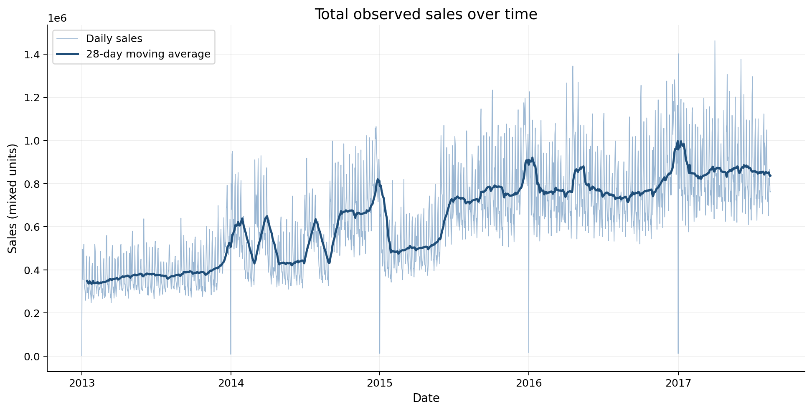

The moving average shows growth alongside recurring weekly movement, sharp peaks, and several near-zero network dates. The increase is an observed network trend, not necessarily same-store growth: openings, assortment expansion, promotions, and other changes may contribute.

**Operations meaning:** capacity and supplier requirements appear to have increased over the historical period, but planning should separate organic demand changes from store-network changes before setting long-term commitments.

### 5.2 Calendar patterns

Sunday has the highest average daily network sales at **825.2k**, followed by Saturday at **772.2k**. Thursday is lowest at approximately **505.3k**. December is the highest month at **808.6k average daily sales**, well above the remaining monthly averages.

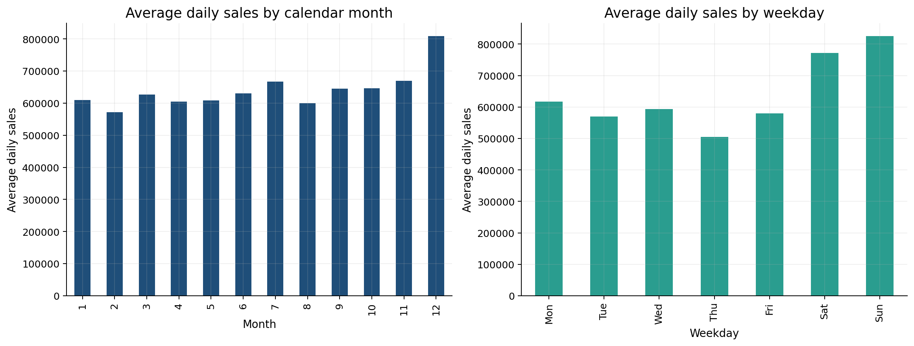

**Operations meaning:** weekend and year-end planning should review staffing, checkout capacity, delivery timing, shelf replenishment, and supplier coordination. These network patterns should be refined by store and family before implementation.

### 5.3 Store differences

Store 44 has the highest total observed sales at approximately **62.1 million mixed units**, followed by Stores 45, 47, 3, and 49. Average daily sales also differ substantially across anonymized store types.

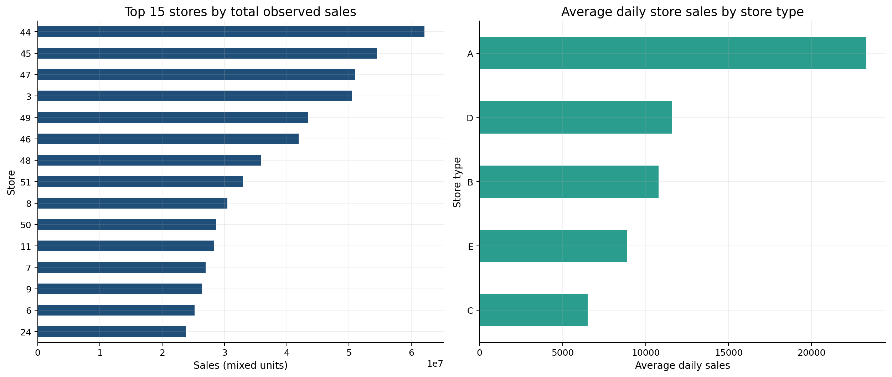

Raw store rankings must be interpreted with lifecycle coverage. Stores 20, 21, 22, 29, 42, 52, and 53 do not meet the 90% mature-store coverage rule and are reported separately for variability analysis.

**Operations meaning:** store scale, format, local market, and opening history should influence labor and replenishment policies. A small or newer store should not automatically be classified as underperforming.

### 5.4 Product-family concentration and variability

| Family | Sales share | Daily-demand CV | Interpretation |
|---|---:|---:|---|
| Grocery I | 31.99% | 0.303 | Very high volume, relatively stable |
| Beverages | 20.21% | 0.490 | High volume, moderate variability |
| Produce | 11.43% | 0.849 | High volume, volatile |
| Cleaning | 9.08% | 0.263 | High volume, relatively stable |
| Dairy | 6.01% | 0.358 | Important and comparatively stable |

The leading four families contribute approximately **72.7%** of family-level observed sales. Produce combines commercial importance with much greater variability than Grocery I or Cleaning.

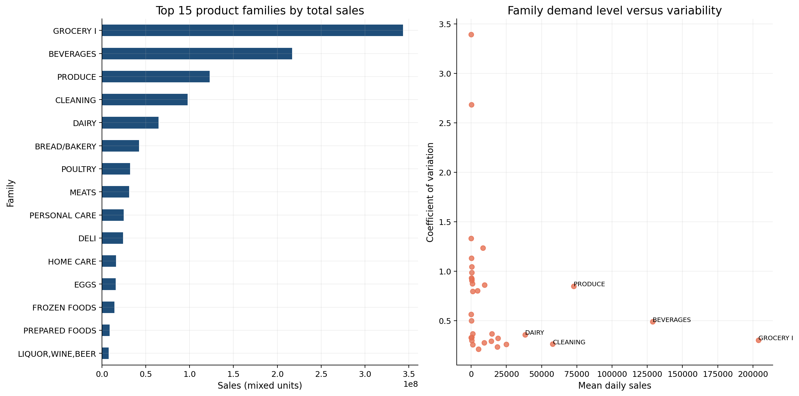

**Operations meaning:** high-volume stable families can anchor routine supplier and capacity cycles. High-volume volatile categories require closer monitoring, shorter review intervals, and scenario-based planning.

### 5.5 Store-family concentration

The selected-store heatmap shows that category importance differs substantially by location. Stores 44 and 45 have much larger selected-family sales than Stores 17, 25, and 32, while Grocery I dominates most selected stores.

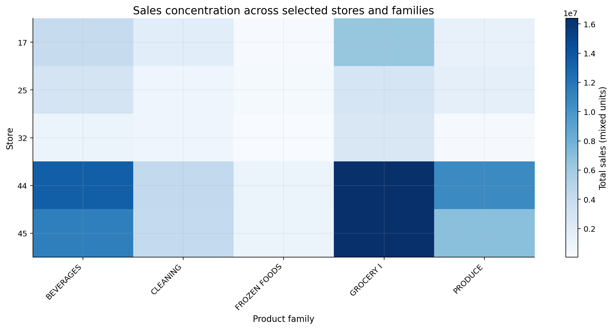

**Operations meaning:** network-level category policies should allow store-level exceptions. The same product family can create different workload and replenishment requirements across locations.

### 5.6 Promotions

Promoted rows generally show higher mean observed sales, but the ratios are heterogeneous. Among high-volume families, the promoted/non-promoted mean-sales ratio is approximately:

- Produce: **3.08**
- Home Care: **3.04**
- Beverages: **2.49**
- Dairy: **1.95**
- Grocery I: **1.62**
- Cleaning: **1.43**

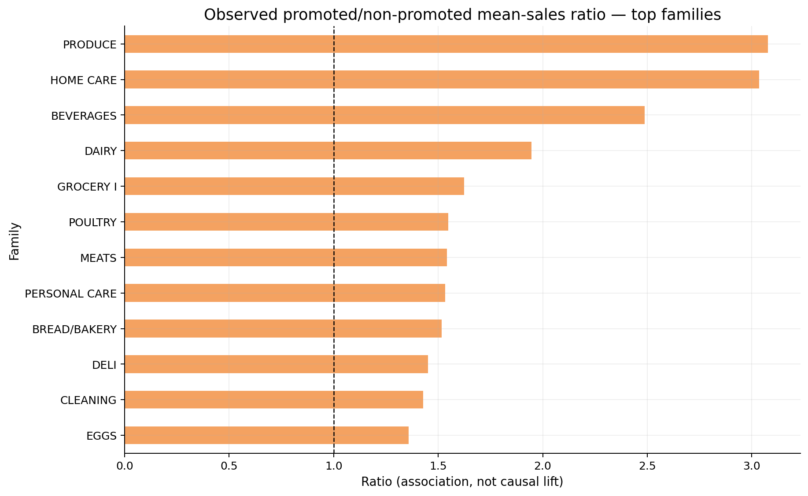

These ratios are **associations, not causal promotion lift**. Promotions may be targeted to periods, products, or stores already expected to sell differently. Low-volume families can also produce unstable ratios when the non-promoted denominator is small.

**Operations meaning:** promotion calendars should be coordinated with replenishment, staffing, receiving, and shelf capacity. Incremental lift should be estimated through a stronger causal design before financial claims are made.

### 5.7 Holidays and events

Holiday store-days average approximately **13.8k mixed units**, compared with **11.6k** on non-holiday store-days—a descriptive difference of **19.1%**.

This comparison does not isolate holiday impact from month, weekday, promotion, location, or event selection. National, regional, and local holidays were matched to the correct stores to avoid attributing local events to the whole network.

**Operations meaning:** holidays should be treated as potential peak and disruption windows. Planning should use event scope and local history rather than one universal holiday multiplier.

### 5.8 Transactions and store traffic

The store-day Pearson correlation between transactions and observed sales is **0.837** for available records.

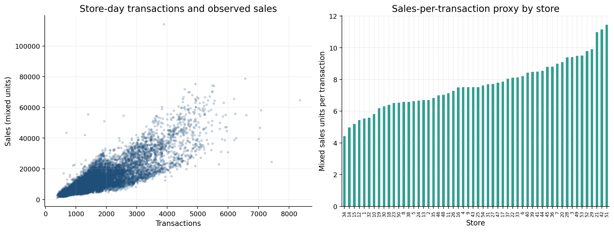

The relationship supports the use of transactions as a store-traffic proxy, but the sales measure combines different product units. Sales divided by transactions is therefore only a mixed-unit basket proxy, not revenue per transaction.

**Operations meaning:** traffic information is useful for staffing and checkout-capacity planning, but it should not replace product-family demand forecasts.

### 5.9 Oil prices

Monthly sales and oil prices have a contemporaneous correlation of approximately **-0.788** in this historical period.

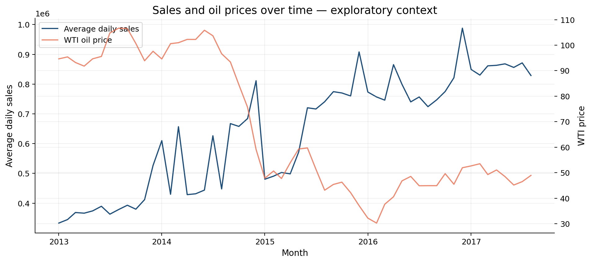

The chart shows opposite broad trends, but this is not decision-ready evidence of an oil-demand relationship. Time trends, inflation, store openings, product changes, and other omitted factors can create a high correlation between unrelated series.

**Operations meaning:** oil price should remain exploratory context unless additional analysis establishes a stable, time-aware relationship.

## 6. Operations Analysis

### 6.1 Demand and variability segmentation

Families were divided using median daily demand and median CV. The result is:

| Segment | Families | Suggested planning posture |
|---|---:|---|
| High demand / Stable | 13 | Standard routines with exception monitoring |
| High demand / Volatile | 4 | Shorter review cycles and flexible capacity |
| Low demand / Stable | 3 | Lower-frequency review where service risk permits |
| Low demand / Volatile | 13 | Selective monitoring; avoid overreacting to percentage changes |

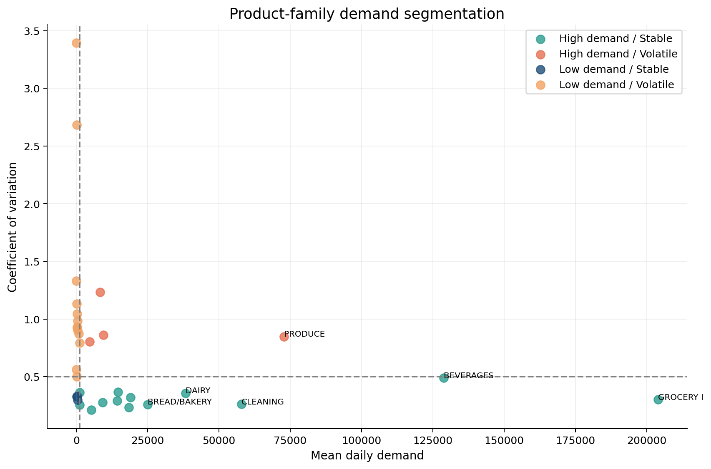

This segmentation is a transparent portfolio framework, not a universal industry classification.

### 6.2 Store operating profiles

Among stores with at least 90% transaction and active-sales coverage, Store 25 has the highest daily-demand CV at **0.702**. Stores with incomplete lifecycle coverage are excluded from this comparison rather than labeled volatile because of pre-opening zeros.

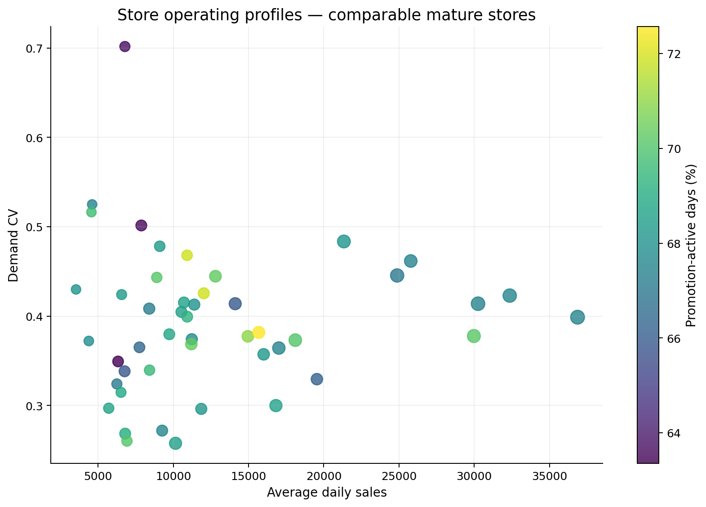

**Operations meaning:** comparable mature stores still show meaningful differences in scale and variability. Store-specific staffing, receiving flexibility, and review tolerances are more defensible than one network rule.

### 6.3 Peak-demand planning

Weekend and December peaks can affect several linked processes:

- labor scheduling and checkout coverage;
- receiving and backroom capacity;
- shelf replenishment frequency;
- supplier delivery windows;
- promotion execution and availability monitoring.

The data supports planning reviews ahead of these periods, but not exact capacity targets without service-time, labor-productivity, stock, or delivery-capacity data.

## 7. Forecasting as Operational Support

### 7.1 Forecast design

The target is daily sales for three representative store-family series. The final 60 observations form a chronological validation period. Models include:

- one-day naive;
- weekly seasonal naive;
- Holt-Winters exponential smoothing;
- Random Forest using lagged sales, rolling means, calendar fields, promotions, and holiday indicators.

Lag and rolling features are shifted before use. Realized future transactions are excluded because they would not be known at forecast time.

### 7.2 Why there is no confusion matrix

A confusion matrix evaluates **classification**, where each observation belongs to a category such as yes/no, high/low, or fraud/not fraud. This project forecasts a **continuous numerical value: daily sales**. Creating a confusion matrix would require arbitrarily converting sales into classes and would discard information about the size of forecast errors.

The appropriate evaluation measures are:

- **MAE:** average absolute error in sales units; easy to interpret operationally.
- **RMSE:** penalizes large misses more strongly; useful when peak errors are costly.
- **RMSLE:** evaluates proportional error and reduces domination by high-volume series.
- **Series-level comparison:** checks whether the same model works consistently across different store-family patterns.
- **Validation plot:** shows whether models miss peaks, timing, or level changes.

### 7.3 Model results

| Model | Average MAE | Average RMSE | Average RMSLE |
|---|---:|---:|---:|
| Random Forest, rolling one-day | **414.41** | **592.87** | **0.258** |
| Holt-Winters | 647.09 | 789.75 | 0.286 |
| Seasonal naive, lag 7 | 718.64 | 945.90 | 0.315 |
| Naive, lag 1 | 910.54 | 1,104.41 | 0.334 |

The Random Forest's average MAE is **42.3% lower** than the weekly seasonal-naive baseline in this validation design. However, averaging MAE across differently scaled series gives more influence to high-volume series, so RMSLE and series-level winners are also reported.

| Store-family series | Best model | MAE |
|---|---|---:|
| Store 45 — Grocery I | Random Forest | 982.09 |
| Store 32 — Grocery I | Random Forest | 252.30 |
| Store 32 — Frozen Foods | Holt-Winters | 7.51 |

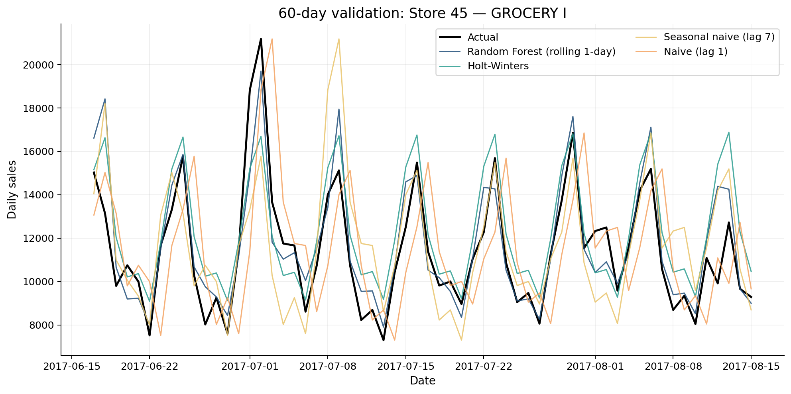

The Random Forest uses rolling one-day realized history, while Holt-Winters produces a fixed 60-day path from the training cutoff. The results therefore compare useful operational procedures, but not perfectly identical information-update schedules.

**Conclusion:** forecasting adds evidence beyond simple baselines, but the winning method varies by series. A pilot should retain the weekly seasonal-naive forecast as a transparent benchmark and monitor errors by store-family.

## 8. Managerial Recommendations

| Evidence-based finding | Operational implication | Possible action |
|---|---|---|
| Grocery I and Cleaning are high-volume and relatively stable | Large predictable flows can support repeatable routines | Use regular review and supplier cycles, with exception monitoring |
| Produce and other high-demand/volatile families combine importance with uncertainty | Long fixed planning cycles may respond slowly to demand changes | Use shorter review cycles, scenario ranges, and closer supplier coordination |
| Sunday, Saturday, and December have the highest average demand | Recurring peaks can strain labor, checkout, receiving, and shelves | Review rosters, delivery windows, and replenishment frequency ahead of peaks |
| Mature-store variability differs across the network | One store rule may over- or under-prepare locations | Use store-specific planning tolerances and treat opening/ramp-up stores separately |
| Promotion associations differ by family | Promotion pressure is category-specific | Coordinate promotions with replenishment and staffing; test causal lift separately |
| Forecast winners vary by series | One universal forecasting model may be fragile | Run model-versus-seasonal-baseline monitoring by store-family |

## 9. Inventory Implications

The findings suggest where inventory processes may need differentiation:

- stable high-volume families may support regular replenishment rhythms;
- volatile important families may require more frequent review and flexible supplier arrangements;
- weekend, holiday, and December periods may require advance availability checks;
- promotion planning should include supply and shelf-capacity coordination;
- forecast uncertainty should be retained rather than converted into a single unquestioned order quantity.

These are planning implications, not an inventory optimization result. Safety stock, reorder points, order quantities, and service-level trade-offs require stock-on-hand, stockout history, lead times, supplier constraints, costs, margins, and target service levels.

## 10. Limitations

1. Sales are observed outcomes and may be constrained by stockouts or closures.
2. Product-family sales combine different physical units and are not revenue or margin.
3. Promotion, holiday, transaction, and oil analyses are observational.
4. Store openings and coverage differences affect network comparisons; mature-store rules were used where appropriate.
5. The detailed subset is representative by transparent rules but is not a statistical sample.
6. Forecast evaluation covers three series and one 60-day historical holdout.
7. The Random Forest and Holt-Winters results reflect different forecast-update procedures.
8. Results describe one retailer and historical period and may not generalize without revalidation.

## 11. Conclusion

Historical sales and operational context provide useful support for grocery retail planning when the analysis distinguishes demand scale, variability, calendar peaks, store lifecycle, promotion association, and forecast uncertainty.

The strongest evidence supports differentiated operations:

- prioritize high-volume families without assuming they are equally predictable;
- prepare for recurring weekend and year-end peaks;
- compare mature stores separately from opening or incomplete-history stores;
- coordinate promotions with operating capacity while avoiding causal claims from descriptive ratios;
- use forecasts alongside transparent baselines and monitor performance by series.

The project demonstrates how data science can support Operations Management without reducing the work to a model leaderboard. The analytical value lies in connecting trustworthy evidence to planning choices and clearly stating where additional operational data is required.

## Appendix — Reproducibility and Evidence

- Executed notebooks: `notebooks/01_data_understanding.ipynb` through `notebooks/06_managerial_insights.ipynb`
- Running findings: `reports/findings.md`
- Evidence tables: `reports/tables/`
- Presentation-ready figures: `reports/figures/`
- Reusable code: `src/`
- Raw data setup instructions: `data/README.md`

All figures and numerical statements in this report are derived from the locally verified Kaggle competition files. Raw competition files are excluded from Git.
